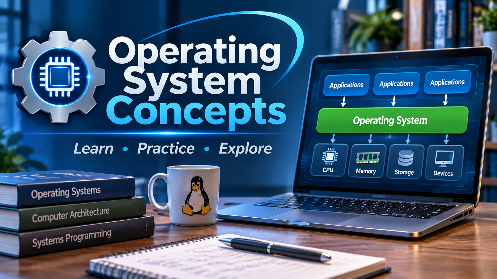

<p align="center">
  
</p>

# Operating System Concepts

[](https://github.com/scttech/operating_system_concepts/actions/workflows/pages.yml)

**[Live demo: https://scttech.github.io/operating_system_concepts/](https://scttech.github.io/operating_system_concepts/)**

An interactive, static website for learning operating-system concepts. Each module has a short explanation,
live d3.js simulations whose parameters students can change, and self-check questions with instant answers.
There is also a searchable glossary, an FAQ, a cheat sheet, a mixed practice quiz, **randomized calculation problems
with worked solutions**, and **hands-on Python labs**.

**Study tools** (`pages/study.html`): quiz questions with instant feedback, glossary **flashcards** that return more often until you know them,
**scenario questions** (which scheduler, lock, isolation or OS fits this situation, and why), a **timed exam mode** with a review of every miss,
and a private **progress record** kept only in the learner's own browser (exportable, importable, clearable). Each module also states
what you should be able to do, its key takeaways, and free further reading. Result tables can be copied or downloaded as CSV, and two
schedulers or two page-replacement policies can be compared side by side on the same workload.

**Shareable setups:** 22 simulations (both scheduler and page-replacement comparisons, Banker's, paging, memory allocation, disk, Amdahl's law, RAID, SSD wear, journaling, the stack-overflow demo and more) have a "Copy link to this setup" button.
The link holds the inputs (for example `#scheduling.algo=RR&scheduling.q=3`), so an assignment can say "run this exact case and explain it". Links are validated, never trusted.

**Paths and teaching:** `pages/paths.html` offers ordered routes through the material for one goal (programs, memory, concurrency, security, performance, other designs).
Every module page ends with discussion and journal prompts. `pages/teaching.html` is for instructors: common misconceptions, a classroom demonstration
and what to listen for in each prompt, for every module.

**On paper** (`pages/handouts.html`): a study guide with check-off objectives, a quiz worksheet with a separate answer key, and a glossary sheet, for the
modules you choose. Every page also has a print stylesheet, and the cheat sheet prints in two columns.

No build step, no framework, no CDN: open the files or serve the folder. d3 v7.9.0 is vendored in `js/vendor/`.

**Publishing your own copy**

1. Copy the folder (the MIT license allows it) and push it to a GitHub repository; in its settings, set Pages to deploy from GitHub Actions.
2. In `js/data/modules.js`, set `OSData.site.repo` to your repository and `OSData.site.url` to the address your copy will have, then run `npm run build`
   (this rewrites the link-preview tags that contain the address).
3. Run `npm test`. The workflow in `.github/workflows/pages.yml` tests and deploys on every push to `main`.

**Where things are**

| Folder | Holds |
|---|---|
| `index.html`, `404.html` | the home page and the not-found page (the only pages at the root, as GitHub Pages expects) |
| `pages/` | the site-level pages: study tools, glossary, FAQ, cheat sheet, search, handouts, paths, teaching notes, problems, labs index |
| `modules/`, `labs/` | one page per lesson and per lab |
| `js/`, `css/`, `images/` | scripts (`data/` holds the content, `lib/` the tested logic, `sims/` the simulations, `pages/` page scripts), the stylesheet and the pictures |
| `examples/`, `labs/code/` | the real C and Python programs shown in lessons and labs |
| `tests/`, `tools/` | the test suites, and the tools that generate files or audit the pages |

Pages at the old root addresses (for example `problems.html#p=disk:48213:2`) still work on the published site: the deploy step adds a small redirect page for each one.

## Run locally

```bash
python -m http.server 8000      # or: npm run serve
# then open http://localhost:8000
```

(Opening `index.html` directly from disk also works, because the site uses classic scripts rather than ES modules.)

## Modules

| # | Topic | Interactive content |
|---|-------|---------------------|
| 1 | OS fundamentals & system calls | System-call walkthrough (user/kernel mode) |
| 2 | Security & access control | chmod/umask calculator, access-control matrix (ACL vs. capabilities) |
| 3 | Security in depth | Stack-smashing simulator with canary, NX, ASLR and information leaks, password-guessing time estimates, salted and stretched hashing demo, STRIDE threat-modeling exercises, C and Python examples for a stack frame and for password hashing |
| 4 | The boot process | Boot stepper (BIOS, UEFI, Secure Boot, with injected failures), editable 512-byte MBR viewer, service start-order scheduler with critical path, chain of trust, C and Python examples for the MBR and for dependency ordering |
| 5 | Processes | Process state diagram, fork() process tree |
| 6 | CPU scheduling | FCFS / SJF / SRTF / RR / Priority with Gantt charts and metrics |
| 7 | Threads & parallel performance | Amdahl's law explorer, context-switch overhead |
| 8 | Advanced scheduling | Multilevel feedback queue with priority boost, rate-monotonic vs EDF with exact schedulability analysis, multicore work stealing with migration cost, C and Python examples for real-time scheduling and CPU affinity |
| 9 | Process synchronization | Race-condition lab, bounded-buffer semaphores |
| 10 | Monitors & readers–writers | Mesa-semantics stepper (if vs while, with random-schedule trials), readers–writers timeline with reader, writer and fair policies and a starvation flag, C and Python examples for condition variables and read-write locks |
| 11 | Deadlocks | Dining philosophers (4 strategies), Banker's algorithm |
| 12 | Inter-process communication | Pipe and message-queue explorer (blocking, end of file, broken pipe), IPC cost comparison, C and Python examples for pipes, sockets and shared memory |
| 13 | Memory management | First/best/worst-fit & fragmentation, paging address translation, **multi-level page-table walk with a TLB** (16-bit teaching layout, 32-bit x86, x86-64), C and Python code tabs, an opt-in "Going deeper" section |
| 14 | Virtual memory | FIFO / LRU / OPT / Clock, Belady's anomaly, effective access time |
| 15 | Disk scheduling & I/O | FCFS / SSTF / SCAN / C-SCAN / LOOK / C-LOOK |
| 16 | File systems | Allocation methods, inode capacity calculator |
| 17 | Storage reliability | RAID levels with failing disks, XOR parity and rebuild, rebuild-risk estimates, SSD write amplification and wear, journaling crash points, C and Python examples for parity and for a write-ahead log |
| 18 | Beyond Windows, macOS & Linux | OS family tree, **compare tool** for 14 systems: Android, iOS, Qubes OS, Raspberry Pi OS, ChromeOS, FreeBSD, FreeRTOS, QNX and the IBM mainframe/midrange systems z/OS (MVS), z/VSE and IBM i |
| 19 | Virtualization & containers | What-runs-on-what stacks, namespace explorer, CPU and memory control groups, VM-exit counter, C and Python examples for namespaces and resource limits |

### Animations

Playback controls (restart, back, play/pause, step, speed) let students watch a simulation unfold: the CPU scheduler
(Gantt chart, CPU, ready queue), page replacement, the disk arm, Amdahl's-law timeline across cores, `fork()` trees,
the Banker's safety check, the race-condition lab, and process-state auto-play. The animations respect the
operating system's "reduce motion" setting.

### Calculation practice

[pages/problems.html](pages/problems.html) generates a fresh problem every time (scheduling, page replacement, disk scheduling, paging,
effective access time, Banker's algorithm, memory allocation, inode file size, Amdahl's law, Unix permissions) at two
difficulty levels, checks the answer, and shows a step-by-step worked solution. Each problem has a code such as
`disk:48213:2`. The same code always gives the same problem, so a link like `pages/problems.html#p=disk:48213:2` can be used in an
assignment. Lessons link to the matching topic (`pages/problems.html#topic=scheduling`). The generators are pure logic in
`js/lib/problems.js`.

### Source viewer and language tabs

Code listings come from real files and are syntax-highlighted with [Prism](https://prismjs.com/) (vendored, with C, Python and shell
grammars; colours chosen to meet WCAG AA contrast in light and dark themes). Comments numbered `(1)`, `(2)` become badges that the
lesson text can refer to, and each listing has the language, a Download link and a Copy button. Where a concept is shown in more than one
language, a `<div class="code-tabs">` offers **C | Python** tabs (arrow-key accessible; the choice applies to every sample on the page and is
remembered). Examples live in `examples/`, labs in `labs/code/`, and `npm run build:labs` injects the files into the pages.
`npm run vendor:prism` rebuilds the highlighter from the `prismjs` dev dependency.

### Python labs

Four labs in [labs/](labs/) (processes, threads and the GIL, system resources with psutil, semaphores and deadlock) with
real, runnable scripts in `labs/code/`, guided "what to notice" notes, experiments, common mistakes and reflection
questions. The code shown on each lab page is injected from the script files by `npm run build:labs`, so what students read
is exactly what they download. Sample output comes from real runs. Python is not run in the browser: `os.fork`, real threads
and `psutil` need a real operating system.

## Tests

Tests use [QUnit](https://qunitjs.com/). The same test files run two ways:

```bash
npm install
npm test                 # headless, in Node: logic, data, Python labs, and page tests (jsdom)
npm run audit            # real browsers: layout at phone/tablet/desktop widths, accessibility (axe), console errors
```

or open `tests/index.html` in a browser to run the logic and data tests there (checked in Edge, Chrome and Firefox).

`npm test` needs **Python 3** on the PATH (set `PYTHON` to choose one) to run the labs. For the `psutil` checks, install it
(`python -m pip install psutil`) or point `PYLIB` at a folder that contains it
(`python -m pip install --target <folder> psutil`). The Linux-only `fork` lab runs for real on Linux and macOS. On Windows
the test checks that it refuses politely, and `LAB_DOCKER=1 npm test` runs it in a Linux container if Docker is installed.
`npm run audit` drives locally installed browsers (`AUDIT_BROWSERS=edge,chrome,firefox`), so it is not part of `npm test`.

What is covered:

* **Problems** (`tests/problems.test.js`): every generated answer is checked against an *independent* re-computation
  (separate simulators, closed-form formulas, a brute-force search over all orderings for Banker's), plus textbook cases,
  reproducibility, link-code validation and answer checking.
* **Page tables** (`tests/pagetable.test.js`): address splitting against independent BigInt shifts, walks against a direct mapping, table
  counts against an independent prefix count on random configurations with 1 to 4 levels, and TLB behavior (LRU versus FIFO, capacity,
  never caching a fault).
* **Lesson code examples** (`tests/examples.test.js`): every example (page-table translation, system call versus stdio, file modes, threads, spinlock, page faults, inode links) is
  compiled in C with `-Wall -Wextra -Werror -pedantic` and run, its Python partner is run, and both must print exactly the expected lines, byte for byte the same (the page-table
  and thread-sum expectations come from independent calculations). A further test requires every example to be shown in a lesson with a note for each language. This needs a C compiler
  (`CC`, `gcc`, `cc` or `clang`); without one set `EXAMPLES_DOCKER=1` to compile in a throwaway Alpine container, or the C checks are skipped. Linux CI uses glibc, so also try `EXAMPLES_IMAGE=debian:stable-slim` (with `EXAMPLES_DOCKER=1`) before pushing.
  CI (Linux) has `gcc`.
* **Python labs** (`tests/labs.test.js`): every lab script is actually executed and its output checked (a lock fixes the
  race, naive philosophers deadlock, fork and zombie behavior on Linux, and so on), and each lab page must show exactly the
  script it describes.

* **Logic** (`js/lib/*`): textbook examples with known answers (e.g. FIFO/LRU/OPT = 15/12/9 faults, disk totals 640/236/331/382/299/322,
  Banker's safe sequence) plus property tests (invariants for every scheduler on random workloads, dining-philosopher safety).
* **Data** (`tests/data.test.js`): quiz questions are well formed, glossary terms unique, modules numbered sequentially.
* **Pages** (`tests/pages.test.js`): every HTML page is loaded in jsdom with its real scripts. The tests check for script errors,
  broken links and images, every simulation mounting, and drive the controls (sliders, selects, buttons, the animation
  player and the OS compare tool) to confirm the numbers.

## Deploying to GitHub Pages

`.github/workflows/pages.yml` runs the tests and then publishes the site. In the repository settings choose
**Pages → Build and deployment → Source: GitHub Actions**, then push to `main`.

## Adding content

* **Quiz question:** add a tuple to `js/data/quizzes.js` (`[module, question, choices, correctIndex, explanation]`).
  Choices are shuffled when displayed.
* **Glossary term / FAQ:** add to `js/data/glossary.js` or `js/data/faq.js`. In a lesson, `<dfn data-term="Deadlock">deadlock</dfn>`
  gives a hover definition that links to the glossary, and marks the spot the glossary links *back* to ("First discussed in
  Module 11 (…)"). After adding or moving terms in lessons, run `npm run build:glossary` to regenerate
  `js/data/glossary-index.js`. The tests fail if that file is out of date, and every term must be discussed in some lesson.
* **Study aids:** each module's learning objectives, takeaways and further-reading links are in `js/data/study.js` (one entry per module;
  a test checks the shape and that every link is `https`). Scenario questions are in `js/data/scenarios.js`. Flashcards come from the glossary.
* **Progress and privacy:** progress lives in `localStorage` under one key and never leaves the browser. Its logic is `js/lib/progress.js`, and
  imports are validated strictly because exported text is untrusted.
* **Search:** the site-wide search (`pages/search.html`) reads the glossary, FAQ, labs, module list and OS profiles directly, and the text of
  every lesson section, lab guide and cheat-sheet section from `js/data/search-index.js`. After editing any page text, run
  `npm run build:search`; the tests fail if it is out of date. Headings get link targets automatically, so you do not need to give them ids.
* **Course parts:** `OSData.parts` in `js/data/modules.js` groups the modules into parts and sets the reading order (the home page,
  the Modules menu and the Previous/Next links all follow it). A new module must be listed in exactly one part; a test checks this.
* **Simulation:** put pure logic in `js/lib/` (with a test), write the UI in `js/sims/` using `OSUI.register("name", fn)`,
  then drop `<div data-sim="name"></div>` into a page and include the scripts.
* **Code sample in two languages:** put `name.c` and `name.py` in `examples/` with the same `(1)`, `(2)` comment numbers and identical
  output, show them with `<div class="code-tabs">` containing two `<pre class="code" data-src="examples/name.c">` blocks (plus optional
  `<div class="lang-note" data-lang="python">` notes), run `npm run build:labs`, and add a run-and-compare test to `tests/examples.test.js`.
* **Practice problem:** add a generator (`random` draws the numbers, `build` computes the answer and the steps) to
  `js/lib/problems.js`, then add an *independent* check and a textbook case to `tests/problems.test.js`.
* **Lab:** put the script in `labs/code/`, add a page in `labs/` containing
  `<pre class="code" data-src="labs/code/yourlab.py"></pre>`, list it in `js/data/labs.js`, run `npm run build:labs`, and add
  a run-and-check test to `tests/labs.test.js`.
* **Module:** add an entry to `js/data/modules.js` and create `modules/NN-slug.html` (copy an existing page).
  The navigation, home page cards and previous/next links update automatically.

## Contributing and changes

Corrections, questions and ideas are welcome: see [CONTRIBUTING.md](CONTRIBUTING.md) (it also lists the generated files to refresh and how to run the tests
the way CI does) and use the issue forms under **Issues**. Every page's footer links to them. What changed between versions is in
[CHANGELOG.md](CHANGELOG.md). If you copy this project for your own course, set `OSData.site.repo` in `js/data/modules.js` to your repository
(or `""` to hide the feedback link), and replace the live-demo link and badge at the top of this file.

## Roadmap

Planned improvements, in suggested order, are tracked in [ROADMAP.md](ROADMAP.md).

## License

Released under the [MIT License](LICENSE.txt). **You are free to copy, adapt, translate, redistribute and use this material
for your own courses**, including commercially. The only condition is that the copyright notice and the license text stay
with copies or substantial portions of the work. There is no warranty. The license applies to the code, the lesson text, the
quiz questions, the labs and the images in this repository. Third-party code keeps its own license (see below).

The copyright line in `LICENSE.txt` currently reads "The Operating System Concepts contributors". If you want it to name a
person or organization, edit that one line before publishing. Everyone who adapts the project can add their own line as well.

## Third-party software

* [d3](https://d3js.org/) v7.9.0, ISC license (`js/vendor/d3.LICENSE.txt`)
* [Prism](https://prismjs.com/) 1.30.0, MIT license (`js/vendor/prism.LICENSE.txt`): syntax highlighting
* [QUnit](https://qunitjs.com/) 2.24.1, MIT license (`tests/vendor/QUNIT-LICENSE.txt`), test-only
* Development-only tools installed by `npm install` and not shipped with the site: jsdom (MIT), puppeteer-core (Apache-2.0), axe-core (MPL-2.0)

Simulations are simplified for teaching and do not model every detail of real operating systems.
